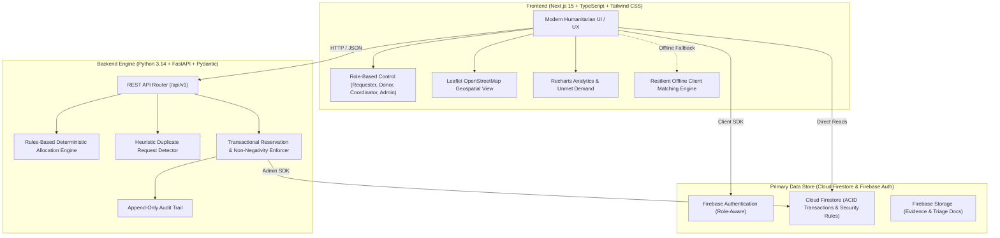

# ResQFlow — Intelligent Community Emergency Resource Allocation Platform

> **Notice:** ResQFlow is an experimental humanitarian technology and coordination software platform designed for community emergency supplies coordination (floods, cyclones, localized disasters). **It is clearly labelled as demonstration software and does NOT replace official national or regional emergency response services (e.g., 911 / 112 / NDRF).**

---

## 1. System Architecture



---

## 2. Technology Stack

- **Frontend**: Next.js 15 (App Router), React 19, TypeScript (Strict Mode), Tailwind CSS v4, Lucide React icons, Recharts, Leaflet with OpenStreetMap.
- **Backend**: Python FastAPI, Pydantic v2, Uvicorn, Pytest, Python Threading Mutex for concurrency locks.
- **Database & Storage**: Firebase Authentication, Cloud Firestore (primary database), Firebase Storage (authorisation-gated evidence), Firebase Security Rules.
- **Testing**: Pytest automated suite (12 test suites covering race conditions, negative inventory prevention, unit compatibility, expiry constraints).

---

## 3. Core Features & Invariants

### 1. Role-Based Access Control
- **Requester**: Register aid requests, select urgency (Critical, High, Normal), specify needed-by deadlines, view allocation updates, and confirm receipt or dispute discrepancies.
- **Donor**: Register available inventory, set expiry dates and handling constraints, track available vs reserved quantities.
- **Coordinator**: Review requests, run intelligent rules-based matching, inspect natural-language reasonings, review flagged duplicates, approve allocations, and authorize overrides.
- **Administrator**: Verify humanitarian organisations, inspect immutable audit trails, and manage account statuses.

### 2. Intelligent Rules-Based Matching Engine
- **Category & Unit Compatibility**: Matches compatible categories (e.g. Drinking Water & Water, Rations & Food) and checks unit compatibility.
- **Urgency Priority**: Prioritizes `CRITICAL` (+100 pts) > `HIGH` (+50 pts) > `NORMAL` (+20 pts).
- **Deadline Sensitivity**: Prioritizes imminent deadlines (< 24 hours).
- **Shelf-Life & Expiry Protection**: Automatically rejects expired supplies and prioritizes soon-expiring stock to prevent waste.
- **Proximity**: Calculates Haversine distances in km; handles missing coordinates gracefully without crashing.
- **Safe Partial Allocations**: When depot stock is insufficient, satisfies partial demand and tracks outstanding unmet demand.
- **Duplicate Detection**: Transparently flags duplicate submissions for human review without silently dropping requests.
- **Natural Language Explanations**: Produces clear bullet points explaining every decision.

### 3. Safe Transactional Stock Reservation
- Re-checks available stock at approval time.
- Ensures requests still need the proposed quantity.
- Enforces strict non-negative inventory invariants.
- Uses idempotency keys (`idempotency_key`) to prevent duplicate reservations during network retries.
- Thread-safe mutexes prevent concurrent coordinators from double-allocating identical depot inventory.
- Full release of reserved stock back to available status upon cancellation.

### 4. Fulfilment & Delivery Lifecycle
```
Reserved ──▶ Dispatched ──▶ Partially Received ──▶ Received (Fulfilled)
   │                           │
   ▼                           ▼
Cancelled (Stock Released)  Disputed (Under Investigation)
```

---

## 4. Cloud Firestore Schema

### `users`
`{ uid, displayName, email, role: "REQUESTER"|"DONOR"|"COORDINATOR"|"ADMIN", organisationId, accountStatus, createdAt, updatedAt }`

### `organisations`
`{ organisationId, name, organisationType, verificationStatus: "Verified"|"Pending"|"Suspended", serviceArea, createdAt, updatedAt }`

### `aidRequests`
`{ request_id, requester_id, requester_name, item_category, description, quantity_required, quantity_fulfilled, unit, urgency: "CRITICAL"|"HIGH"|"NORMAL", location: { lat, lng, address, approximate }, needed_by, created_at, status: "Submitted"|"Partially Allocated"|"Fully Allocated"|"Fulfilled"|"Cancelled", verification_status }`

### `supplyOffers`
`{ supply_id, donor_id, donor_name, item_category, description, total_quantity, available_quantity, reserved_quantity, unit, location: { lat, lng, address, approximate }, expiry_at, status: "Available"|"Depleted"|"Paused", verification_status }`

### `allocations`
`{ allocation_id, request_id, supply_id, approved_quantity, unit, allocation_status: "Reserved"|"Dispatched"|"Partially Received"|"Received"|"Disputed"|"Cancelled", priority_reasons: string[], approved_by, override_reason, dispatched_quantity, received_quantity, created_at, updated_at }`

### `auditLogs`
`{ audit_id, actor_id, action, entity_type, entity_id, previous_state, new_state, reason, timestamp }`

---

## 5. API Specification

| Method | Endpoint | Description |
|---|---|---|
| `GET` | `/health` | System health check and mode |
| `POST` | `/matching/recommendations` | Execute rules-based matching on requests & supplies |
| `POST` | `/allocations/preview` | Dry-run feasibility simulation without committing |
| `POST` | `/allocations/approve` | Safe transactional reservation (requires idempotency key) |
| `POST` | `/allocations/{id}/cancel` | Cancel allocation and release reserved stock |
| `POST` | `/deliveries/{id}/dispatch` | Record dispatched quantity and driver info |
| `POST` | `/deliveries/{id}/confirm` | Confirm receipt or log discrepancies |
| `GET` | `/audit/logs` | Query immutable audit log trail |

FastAPI Swagger UI is available at `http://localhost:8000/docs`.

---

## 6. Getting Started

### Prerequisites
- Node.js 18+ (tested on v24)
- Python 3.10+ (tested on Python 3.14)

### One-Click Start (Windows)
Simply double-click or drag-and-launch:
- [start.bat](file:///d:/git/ResQFlow-/start.bat): Automatically boots both the FastAPI backend and Next.js frontend, checks virtual environments and dependencies, and opens `http://localhost:3000` in your default browser.
- [stop.bat](file:///d:/git/ResQFlow-/stop.bat): Gracefully stops both backend (port 8000) and frontend (port 3000) processes.

### Manual Setup & Tests

### 2. Frontend Setup
```bash
# Navigate to frontend
cd frontend

# Install dependencies
npm install

# Start development server
npm run dev
```
Open [http://localhost:3000](http://localhost:3000) in your browser.

---

## 7. Automated Test Results

The backend contains automated tests verifying all prompt criteria:
```
tests/test_allocation_engine.py::test_category_and_unit_compatibility PASSED [  8%]
tests/test_allocation_engine.py::test_prioritises_critical_requests PASSED [ 16%]
tests/test_allocation_engine.py::test_partial_allocation PASSED          [ 25%]
tests/test_allocation_engine.py::test_competing_requests_for_same_stock PASSED [ 33%]
tests/test_allocation_engine.py::test_rejects_expired_supplies PASSED    [ 41%]
tests/test_allocation_engine.py::test_missing_location_handling PASSED   [ 50%]
tests/test_allocation_engine.py::test_distance_calculation PASSED        [ 58%]
tests/test_allocation_engine.py::test_transactional_stock_reservation PASSED [ 66%]
tests/test_allocation_engine.py::test_concurrent_stock_reservations_safety PASSED [ 75%]
tests/test_allocation_engine.py::test_cancellation_releases_reserved_stock PASSED [ 83%]
tests/test_allocation_engine.py::test_fulfilment_dispatch_and_confirmation PASSED [ 91%]
tests/test_allocation_engine.py::test_duplicate_request_detection PASSED [100%]

============================= 12 passed in 0.15s ==============================
```

---

## 8. Known Limitations & Production Notes

1. **Demonstration Dataset**: Preloaded disaster scenario datasets represent synthetic community relief data for demonstration.
2. **Emergency Services Integration**: ResQFlow does not make unverified calls to actual government or 911 dispatch lines without official agency integration keys.
3. **Map Tile Usage**: Uses standard OpenStreetMap tiles complying with fair use tile usage policies. For high-volume municipal deployments, a dedicated vector tile server or Mapbox proxy should be configured.
4. **Firebase Credentials**: The application is configured to run smoothly in offline demonstration mode out-of-the-box, and automatically connects to live Cloud Firestore when `NEXT_PUBLIC_FIREBASE_*` environment keys are configured in `.env.local`.
